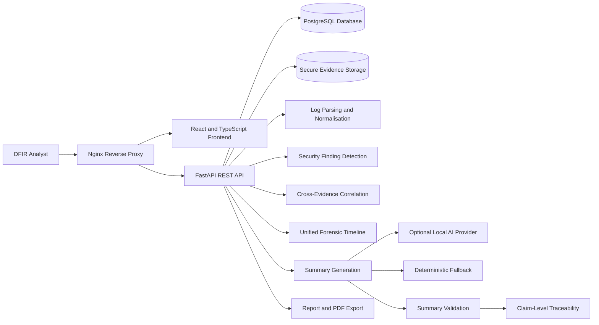
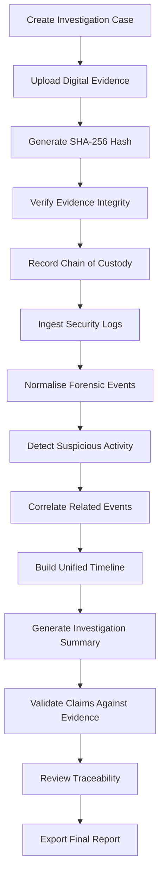
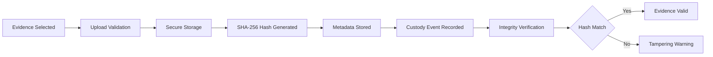
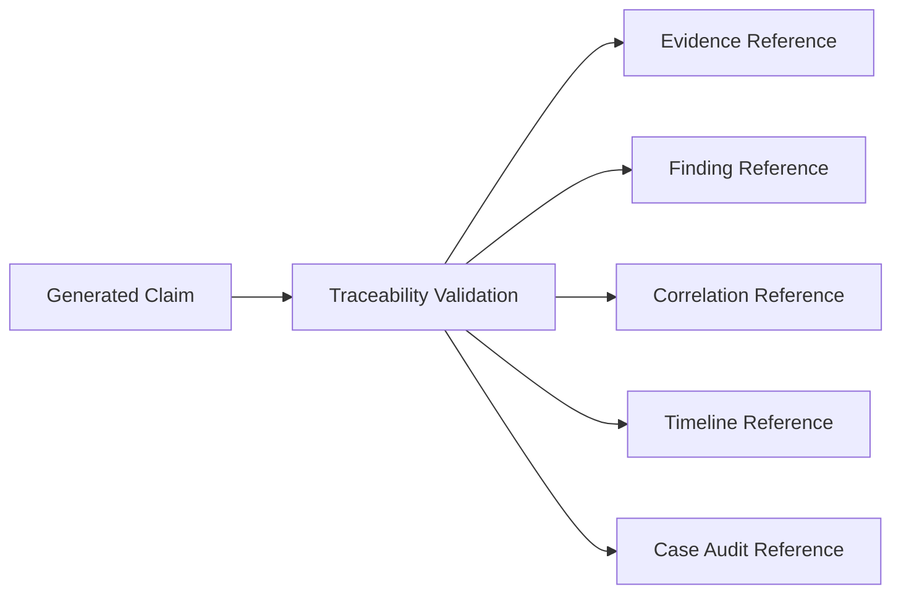
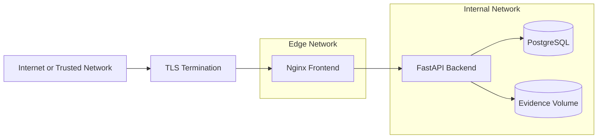

# 🛡️ DFIR Investigation Assistant

## AI-Powered Digital Forensics and Incident Response Platform

A security-focused investigation platform designed to help analysts manage forensic cases, preserve digital evidence, analyse security logs, correlate suspicious activity, construct forensic timelines and produce evidence-grounded investigation reports.

**Final-Year Project · Digital Forensics · Incident Response · FastAPI · React · PostgreSQL · AI-Assisted Analysis**

---

## Project Overview

The **AI-Powered DFIR Investigation Assistant** is a full-stack Digital Forensics and Incident Response platform developed to support structured, secure and traceable cyber-investigation workflows.

The system brings together case management, evidence preservation, log analysis, suspicious-activity detection, cross-evidence correlation, timeline construction, AI-assisted summarisation and professional report generation within one investigation environment.

The project focuses on five central DFIR requirements:

- **Evidence integrity** — detecting modification or tampering through cryptographic hashing
- **Traceability** — linking findings and generated conclusions back to supporting evidence
- **Access control** — restricting sensitive investigative operations through RBAC
- **Investigation efficiency** — reducing manual analysis through automated processing and correlation
- **Report reliability** — generating structured reports that remain grounded in stored forensic records

The platform combines deterministic forensic processing with optional local AI assistance. AI output is validated and supported through claim-level evidence traceability rather than being accepted as an independent source of truth.

---

## Core Capabilities

| Area | Implementation |
|---|---|
| Authentication | JWT access tokens with secure rotating refresh-token sessions |
| Session Security | Server-side session records, token rotation, reuse detection and revocation |
| Authorisation | Role-Based Access Control with granular permissions |
| Case Management | Case creation, updates, severity tracking, status management and soft deletion |
| Audit History | Permanent case and administrative activity records |
| Evidence Protection | Secure upload, SHA-256 hashing, integrity verification and tamper detection |
| Chain of Custody | Persistent custody events linked to users, evidence and timestamps |
| Log Ingestion | Structured ingestion of supported Windows and Linux log sources |
| Event Normalisation | Conversion of different log formats into consistent forensic events |
| Threat Detection | Automated detection and persistence of suspicious security findings |
| Event Correlation | Cross-evidence correlation of related users, hosts, events and timestamps |
| Forensic Timeline | Unified chronological view of investigation activity |
| AI Assistance | Optional local AI provider with deterministic fallback |
| Summary Validation | Evidence-aware validation of generated investigation summaries |
| Traceability | Claim-level links between conclusions and supporting investigation records |
| Reporting | Structured investigation report and PDF export |
| Administration | User, role, permission, account-status and password management |
| Deployment | Development Docker environment and hardened production containers |

---

## System Architecture



The system follows a layered security and investigation model:

1. React presentation layer
2. Authenticated FastAPI REST API
3. JWT and server-side session validation
4. Role and permission enforcement
5. Case and evidence-management services
6. Log parsing and event normalisation
7. Security detection and event correlation
8. Forensic timeline construction
9. AI-assisted or deterministic summary generation
10. Traceability validation and report export
11. PostgreSQL and protected evidence storage

---

## Investigation Workflow



The investigation workflow is designed to preserve the relationship between source evidence, processed events, findings, correlations, timelines and final conclusions.

---

## Authentication and Session Security

The platform uses a two-token authentication model:

- Short-lived JWT access token
- Rotating refresh token
- Server-side authentication session
- Hashed refresh-token storage
- Session identifier validation
- Refresh-token reuse detection
- Logout-based session revocation
- Password-change session revocation
- Administrative reset revocation
- Account-deactivation revocation

When a refresh token is used successfully, the server issues a new access-token and refresh-token pair.

Reusing an older rotated refresh token is treated as suspicious activity and causes the associated session to be revoked.

Authentication tokens are stored in browser session storage rather than long-term local storage.

---

## Role-Based Access Control

The platform applies permission-based access control at both the frontend and backend.

Backend access checks remain authoritative. Frontend controls are used to hide unavailable navigation and administrative actions, but they do not replace server-side enforcement.

Example permissions include:

| Permission | Purpose |
|---|---|
| `cases.read` | View investigation cases |
| `cases.manage` | Create and update cases |
| `evidence.read` | View evidence information |
| `evidence.manage` | Upload and manage evidence |
| `users.read` | View system users |
| `users.manage` | Create and update user accounts |
| `roles.read` | View available roles |
| `roles.manage` | Assign and manage user roles |

Inactive roles and inactive permissions are ignored.

Role assignment requires dedicated role-management authority. A user with account-management permission alone cannot assign privileged roles.

---

## Typical User Responsibilities

Roles are configurable through the permission system rather than being limited to only three fixed account types.

### System Administrator

- Create and manage user accounts
- Activate or deactivate accounts
- Reset user passwords
- Unlock locked accounts
- Assign authorised roles
- Review system-level account information
- Maintain access-control boundaries

### DFIR Investigator

- Create and manage investigation cases
- Upload and review evidence
- Verify evidence integrity
- Inspect custody history
- Ingest supported security logs
- Review detected security findings
- Run event correlations
- Construct forensic timelines
- Generate investigation summaries
- Export final reports

### Reviewer or Read-Only Analyst

- View authorised cases
- Review evidence metadata
- Examine findings and timelines
- Validate investigation conclusions
- Review summary traceability
- Access reports according to assigned permissions

---

## Case Management

Each investigation case can include:

- Unique case identifier
- Investigation title
- Incident description
- Severity level
- Investigation status
- Creation and update timestamps
- Responsible user attribution
- Evidence records
- Security findings
- Event correlations
- Forensic timeline entries
- Investigation summaries
- Exported reports
- Permanent audit history

Cases use controlled soft deletion rather than immediate physical removal.

This preserves historical and forensic accountability while preventing deleted cases from appearing in normal active listings.

---

## Evidence Management

The evidence-management system is designed to preserve integrity and accountability throughout the evidence lifecycle.

### Evidence Controls

- Server-generated evidence identifiers
- Sanitised filenames
- Controlled storage paths
- Configurable upload-size limit
- SHA-256 hashing
- Integrity verification
- Tamper detection
- Chain-of-custody events
- User and timestamp attribution
- Protected evidence downloads
- Attachment-only content disposition
- Generic binary content type
- Browser cache prevention
- Content-sniffing protection

### Evidence Lifecycle



Evidence files are stored in a dedicated persistent volume.

The database stores evidence metadata, cryptographic hashes and custody records. Evidence metadata and stored files should always be backed up together.

---

## Chain of Custody

Each evidence action can be recorded as a custody event.

Custody records may include:

- Evidence upload
- Integrity verification
- Evidence download
- Processing activity
- Analyst identity
- Timestamp
- Action type
- Supporting details

This provides an auditable history of how evidence was handled throughout the investigation.

The platform assists custody documentation but does not replace organisational, legal or jurisdiction-specific evidence-handling procedures.

---

## Supported Log Processing

The platform includes dedicated normalisation services for supported forensic sources.

### Windows Event JSON

Windows event records are converted into structured fields such as:

- Event identifier
- Timestamp
- Host
- User
- Source
- Event category
- Process or service information
- Network information
- Raw-event reference

### Linux Authentication Logs

Linux authentication activity can be normalised into fields such as:

- Timestamp
- Hostname
- Username
- Source IP address
- Authentication result
- Service
- Process identifier
- Event category
- Raw-log reference

Normalisation allows different evidence sources to be analysed through a consistent investigation model.

---

## Security Finding Detection

The security detection service analyses normalised events and persists suspicious activity as security findings.

A finding may include:

- Severity
- Finding category
- Detection reason
- Source event
- Evidence reference
- Host
- User
- Timestamp
- Supporting metadata

Findings are investigative leads rather than automatic proof of compromise.

Every finding should be reviewed together with its original evidence and surrounding timeline context.

---

## Cross-Evidence Correlation

The event-correlation service connects related forensic activity across evidence sources.

Correlation can identify relationships involving:

- Shared users
- Shared hosts
- Repeated IP addresses
- Similar event categories
- Related timestamps
- Authentication patterns
- Multi-stage activity
- Common evidence sources

Correlation results preserve references to the source events used to create them.

This helps investigators move from isolated events to a broader understanding of incident progression.

---

## Unified Forensic Timeline

The forensic timeline combines multiple investigation sources into a single chronological view.

Timeline entries can represent:

- Case activity
- Evidence events
- Chain-of-custody actions
- Normalised log events
- Security findings
- Correlation results
- Investigation summary activity
- Audit records

Timeline data is retrieved using server-side pagination to avoid loading an unlimited number of records into the browser.

Investigators should always confirm:

- Timestamp accuracy
- Timezone assumptions
- Source-system clock differences
- Event-ordering limitations

---

## AI-Assisted Investigation Summaries

The system supports optional local AI-assisted summary generation.

The AI service is designed as an investigation-support mechanism rather than an independent decision maker.

### Summary Generation Sources

Generated summaries can use:

- Case metadata
- Evidence metadata
- Security findings
- Correlation records
- Timeline entries
- Analyst-approved investigation context

### Provider Options

- Approved local AI provider
- Deterministic summary fallback

When the configured local provider is disabled or unavailable, the platform can generate a deterministic evidence-based summary.

This ensures that report generation does not depend entirely on an external model.

---

## AI Validation and Guardrails

Generated investigation text is validated before being treated as reliable investigative output.

Validation controls help reduce:

- Unsupported conclusions
- Incorrect entities
- Incorrect timestamps
- Exaggerated severity
- Hallucinated evidence
- Missing uncertainty
- Untraceable claims

AI-generated conclusions must be reviewed by a qualified analyst before inclusion in a final investigation report.

---

## Claim-Level Evidence Traceability

The traceability system connects generated claims to supporting investigation records.

A claim may reference:

- Evidence
- Log events
- Security findings
- Correlation results
- Timeline entries
- Case records

This allows reviewers to verify why a conclusion was included and whether sufficient supporting evidence exists.



Claims without sufficient support should be revised, qualified or removed.

---

## Investigation Reporting

The reporting subsystem can combine:

- Case details
- Evidence records
- Integrity status
- Chain-of-custody history
- Parsed events
- Security findings
- Correlation results
- Forensic timeline entries
- Validated summaries
- Traceability information

Reports can be generated as structured investigation output and exported as PDF documents.

PDF generation is implemented using ReportLab.

Final reports must still be reviewed for:

- Accuracy
- Completeness
- Evidence support
- Legal sensitivity
- Confidential information
- Organisational reporting standards

---

## Defence-in-Depth Controls

The project applies multiple complementary security controls:

- Argon2 password hashing
- JWT access-token validation
- Rotating refresh tokens
- Server-side authentication sessions
- Refresh-token reuse detection
- Account lockout protection
- Persistent login rate limiting
- Generic authentication failure responses
- Role and permission enforcement
- Dedicated role-assignment permission
- Session revocation after account changes
- Trusted-host validation
- Trusted-proxy network validation
- Restricted CORS origins
- Configurable security headers
- Configurable HSTS
- Generic internal error responses
- Error correlation identifiers
- Evidence hashing
- Evidence filename sanitisation
- Controlled storage paths
- Protected evidence downloads
- No-cache evidence responses
- Permanent case auditing
- Chain-of-custody tracking
- Non-root production containers
- Read-only production filesystems
- Dropped Linux capabilities
- Internal-only database networking

---

## Trusted Proxy Protection

Client-IP resolution accepts forwarded IP information only when the direct connection comes from a configured trusted proxy network.

The resolver evaluates the proxy chain from right to left and selects the nearest untrusted address.

Invalid or trust-all proxy networks are rejected.

This protects login rate limiting and authentication-session metadata from being bypassed through forged `X-Forwarded-For` headers.

---

## Secure Error Handling

Unhandled backend exceptions are logged server-side with a generated error identifier.

The client receives a generic response containing:

- Safe error description
- Unique error identifier
- No-cache response headers
- Content-sniffing protection

Internal stack traces, provider errors and sensitive implementation details are not intentionally returned to clients.

---

## Production Architecture



Only the Nginx frontend port is published in the production Compose environment.

The following services remain internal:

- PostgreSQL
- FastAPI backend
- Database migration service

---

## Production Container Security

The hardened production environment includes:

| Control | Implementation |
|---|---|
| Backend account | Dedicated non-root user |
| Frontend account | Nginx non-root user |
| Root filesystem | Read-only where practical |
| Linux capabilities | All unnecessary capabilities dropped |
| Privilege escalation | `no-new-privileges` enabled |
| Temporary storage | Restricted in-memory `tmpfs` mounts |
| Database exposure | Internal Docker network only |
| Backend exposure | Internal Docker network only |
| Public service | Nginx frontend |
| Logging | Size-limited JSON logs |
| Database migration | Separate one-time migration service |
| Health monitoring | Database, backend and frontend health checks |

TLS must be provided by a trusted reverse proxy, cloud ingress or HTTPS gateway before public deployment.

---

## Performance and Frontend Optimisation

The frontend includes:

- Route-based code splitting
- Lazy-loaded investigation panels
- Server-side pagination
- Bounded API page sizes
- Query caching through TanStack Query
- Production Vite compilation
- Nginx static-file delivery
- Gzip compression

Large investigation views use paginated records instead of requesting unlimited case, timeline, evidence or event data.

---

## Technology Stack

| Component | Technologies |
|---|---|
| Frontend | React 18, TypeScript, Vite |
| Styling | Tailwind CSS |
| Routing | React Router |
| API State | TanStack Query |
| HTTP Client | Axios |
| Animation | Framer Motion |
| Charts | Recharts |
| Icons | Lucide React |
| Backend | Python 3.12, FastAPI |
| ORM | SQLAlchemy |
| Database | PostgreSQL 16 |
| Migration | Alembic |
| Validation | Pydantic |
| Authentication | PyJWT |
| Password Security | Argon2 through pwdlib |
| Reporting | ReportLab |
| Backend Testing | Pytest |
| Frontend Quality | TypeScript compiler and ESLint |
| Development Deployment | Docker Compose |
| Production Deployment | Docker Compose and Nginx |
| CI | GitHub Actions |

---

## Project Structure

```text
dfir-investigation-assistant/
├── backend/
│   ├── alembic/
│   │   └── versions/
│   ├── app/
│   │   ├── api/
│   │   │   └── v1/
│   │   ├── core/
│   │   ├── db/
│   │   ├── middleware/
│   │   ├── models/
│   │   ├── schemas/
│   │   ├── scripts/
│   │   └── services/
│   ├── tests/
│   ├── Dockerfile
│   ├── Dockerfile.prod
│   ├── alembic.ini
│   └── requirements.txt
├── frontend/
│   ├── src/
│   │   ├── api/
│   │   ├── auth/
│   │   ├── components/
│   │   │   ├── cases/
│   │   │   ├── common/
│   │   │   ├── investigation/
│   │   │   ├── landing/
│   │   │   ├── layout/
│   │   │   └── settings/
│   │   ├── pages/
│   │   ├── routes/
│   │   └── types/
│   ├── Dockerfile
│   ├── Dockerfile.prod
│   ├── nginx.prod.conf
│   └── package.json
├── docs/
├── .github/
│   └── workflows/
├── compose.yml
├── docker-compose.prod.yml
├── .env.example
├── .env.production.example
└── README.md
```

---

## Development Setup

### Prerequisites

- Git
- Docker Desktop
- Docker Compose
- Visual Studio Code or another editor

### 1. Clone the Repository

```powershell
git clone https://github.com/tharunsasanka/dfir-investigation-assistant.git
cd .\dfir-investigation-assistant
```

### 2. Create the Backend Environment File

```powershell
Copy-Item .\backend\.env.example .\backend\.env
```

Replace the JWT secret and review the development configuration.

Never commit `backend/.env`.

### 3. Build and Start the Services

```powershell
docker compose -f .\compose.yml up -d --build
```

### 4. Apply Database Migrations

```powershell
docker compose -f .\compose.yml exec backend alembic upgrade head
```

### 5. Create the Initial Administrator

```powershell
docker compose -f .\compose.yml exec backend python app/scripts/create_admin.py
```

Follow the prompts without storing the administrator password in source control.

### 6. Open the Application

| Service | Address |
|---|---|
| Frontend | `http://localhost:5173` |
| API Root | `http://localhost:8000` |
| API Documentation | `http://localhost:8000/docs` |
| API Health | `http://localhost:8000/api/v1/health` |
| Service Health | `http://localhost:8000/health` |
| Database Readiness | `http://localhost:8000/ready` |

---

## Production Deployment

Create a real production environment file:

```powershell
Copy-Item .\.env.production.example .\.env.production
```

Replace all placeholder values:

- PostgreSQL password
- JWT secret
- Database URL
- Trusted hosts
- CORS origins
- Trusted proxy networks
- Published application port

Validate the configuration:

```powershell
docker compose `
  --env-file .\.env.production `
  -f .\docker-compose.prod.yml `
  config
```

Build and start:

```powershell
docker compose `
  --env-file .\.env.production `
  -f .\docker-compose.prod.yml `
  up -d --build
```

Verify:

```powershell
docker compose `
  --env-file .\.env.production `
  -f .\docker-compose.prod.yml `
  ps
```

The default production application address is:

```text
http://localhost:8080
```

Do not deploy publicly without HTTPS.

---

## Testing and Validation

### Backend Test Suite

```powershell
docker compose -f .\compose.yml exec -T backend sh -lc 'cd /app && PYTHONPATH=/app python -m pytest -q -W error::UserWarning'
```

### Backend Compilation

```powershell
docker compose -f .\compose.yml exec -T backend sh -lc 'cd /app && PYTHONPATH=/app python -m compileall -q app'
```

### Frontend Production Build

```powershell
docker compose -f .\compose.yml exec -T frontend sh -lc 'cd /app && npm run build'
```

### Frontend Linting

```powershell
docker compose -f .\compose.yml exec -T frontend sh -lc 'cd /app && npm run lint'
```

### Production Image Build

```powershell
docker compose `
  --env-file .\.env.production.example `
  -f .\docker-compose.prod.yml `
  build backend frontend migrate
```

### Production Smoke-Test Expectations

| Check | Expected Result |
|---|---|
| Database container | Healthy |
| Migration service | Completes successfully |
| Backend container | Healthy |
| Frontend container | Healthy |
| Nginx configuration | Valid |
| `/healthz` | HTTP 200 |
| Frontend `/` | HTTP 200 |
| Protected API without token | HTTP 401 |

The latest production smoke test completed successfully with the expected responses. :contentReference[oaicite:1]{index=1}

---

## Academic Value

This project demonstrates practical understanding of:

- Digital forensics investigation workflows
- Incident-response case management
- Secure evidence handling
- SHA-256 integrity verification
- Chain-of-custody preservation
- Windows and Linux log analysis
- Security-event normalisation
- Suspicious-activity detection
- Cross-evidence event correlation
- Forensic timeline reconstruction
- Authentication and session security
- Role-Based Access Control
- Refresh-token rotation
- Secure API architecture
- AI-assisted forensic analysis
- AI-output validation
- Evidence-grounded claim traceability
- PDF investigation reporting
- PostgreSQL database design
- Docker container hardening
- Secure production deployment
- Automated security testing
- Defence-in-depth architecture

---

## Future Enhancements

- Add support for EVTX, Sysmon XML, PCAP and cloud-security logs
- Add MITRE ATT&CK technique mapping
- Integrate approved threat-intelligence sources
- Add STIX and TAXII support
- Introduce object-lock or immutable evidence storage
- Add digital signatures for exported reports
- Add encrypted off-site backup automation
- Introduce multi-factor authentication
- Add WebAuthn or hardware security-key support
- Add SIEM integrations
- Add secure case-sharing workflows
- Add investigation collaboration and analyst notes
- Add scheduled detection and correlation jobs
- Add centralised monitoring and alerting
- Add full frontend component testing
- Add external secret-manager integration
- Add Kubernetes deployment manifests
- Add forensic evidence retention policies
- Add automated evidence acquisition connectors

---

## Current Limitations

- Supported log formats are currently limited.
- TLS termination is external to the included production Compose stack.
- Evidence storage uses a Docker volume rather than immutable object storage.
- AI assistance is optional and designed primarily for trusted local providers.
- Backup scheduling must be configured by the deployment operator.
- The system does not replace validated forensic acquisition tools.
- Legal admissibility depends on organisational procedures and jurisdiction.
- Generated summaries require analyst review.

---

## Security Notice

This repository is an academic and research-oriented DFIR platform.

It must only be used for:

- Authorised digital-forensic investigations
- Defensive security operations
- Incident-response training
- Academic study
- Controlled cybersecurity research

Do not upload or analyse systems, accounts or evidence without appropriate permission.

Production environments must use:

- Unique strong secrets
- HTTPS
- Restricted trusted hosts
- Restricted CORS origins
- Approved trusted proxies
- Encrypted backups
- Access monitoring
- Organisational evidence-retention procedures

Passwords, access tokens, refresh tokens, environment files, databases, forensic evidence and confidential reports must remain excluded from version control.

AI-generated output must never be accepted as evidence without validation.

---

## Responsible Use

Digital forensics is not only about collecting data.

It requires preserving integrity, maintaining traceability, enforcing access boundaries, validating conclusions and documenting every action in a defensible manner.

The platform is designed to support those responsibilities while keeping the human investigator in control.

---

## Academic Project

**AI-Powered DFIR Investigation Assistant**

**BSc (Hons) Computer Security**

**Final-Year Project**

---

## Author

**Tharun Sasanka**

- Cybersecurity Student
- Digital Forensics and Incident Response Enthusiast
- Full-Stack Developer
- Ethical Hacking Practitioner

GitHub: `tharunsasanka`

---

## About

An AI-powered Digital Forensics and Incident Response platform featuring secure case management, evidence integrity verification, chain-of-custody tracking, automated log analysis, security finding detection, cross-evidence correlation, forensic timeline construction, evidence-grounded summaries and professional investigation report generation.
